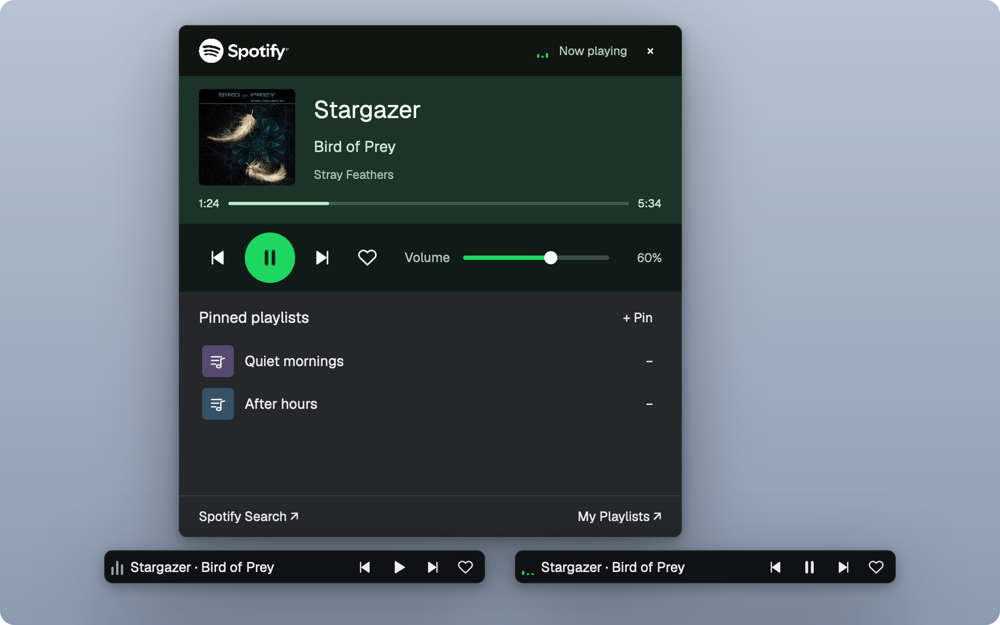

# Herdr Power Tools

Keep an agent's terminal, the file it is changing, and the Git diff side by side in [Herdr](https://herdr.dev). Install the whole workspace or pick the tools you need.


**Agent support.** Agent Usage reads Claude Code and Codex, and the optional Git commit-message writer can use either one. The file editor, search, Git tools and the Spaces sidebar work with ordinary terminals. You can mark agents unread when Herdr recognizes their status.

[See the whole window](docs/images/overview.webp) · [Install and update](#install) · [Upgrading an earlier install](#upgrading-an-earlier-install)

*Every picture is the real app in a demo workspace with fictional projects, sessions and figures.*

## What's here

Each feature has a page with everything it does: every key, limit and edge case.

| Feature | In short | Mod IDs |
|---|---|---|
| [Agent Usage](docs/usage.md) | Whether the agents' limits last the week, and where the usage went | `agent-usage` |
| [Spaces Sidebar](docs/spaces-sidebar.md) | Group spaces, see agent activity and open local DDEV services | `spaces-sidebar` |
| [Mark Agents Unread](docs/unread-agents.md) | Flag idle agents to come back to later | `mark-agents-unread` |
| [Git Panel](docs/git-panel.md) | Commit history, refs, branch review and everyday Git actions | `git-panel` |
| [Git Diff](docs/git-diff.md) | A diff pane, side by side, with the changed words marked | `git-diff` |
| [File Editor](docs/file-editor.md) | Edit and preview files in a pane, also from a path Cmd-clicked in a terminal | `file-editor`, `editor-links` |
| [Project Search](docs/project-search.md) | Search and replace in every file of the project | `project-search` |
| [Back and Forward](docs/back-forward.md) | Return to the tab and pane you left | `back-and-forward` |
| [Quick Actions](docs/quick-actions.md) | Run saved commands for the current project | `quick-actions` |
| [Spotify Mini](docs/spotify-mini.md) | Control the Mac's Spotify player, like a song and open pinned playlists | `spotify-mini` |
| [Go to File](docs/go-to-file.md) | Any file of the project, by some of its name | `go-to-file` |
| [File Explorer](docs/file-actions.md) | The Files panel with icons, change marks, drag and drop and search shortcuts | `file-explorer` |
| [Hide Names](docs/hide-names.md) | Made-up names around the content, for a screenshot or a screen share | `hide-names`, `tabs-names`, `pane-names`, `toast-names` |

The `herdr-powertools` layout puts Files, Search and Git together on the tab bar and shows all of the above, with the panes you're not in faded and the dividers lit on hover. The repository also includes my key bindings and settings, notes for coding agents, and the [scripts that take these pictures](docs/screenshots/README.md).

## The tour

### Agent Usage

**Will the weekly limit last?** One sentence says so for the limit most at risk, Claude's or Codex's, and a ruler for each limit shows which project is spending it.


- **The week as a chart:** what was used against an even pace, and where this pace ends.
- **Burning now:** the projects that used an agent in the last hour, and how fast.
- **Where it went:** tokens and cost by project, model, session and machine, and the year as a calendar.

<kbd>Cmd</kbd>+<kbd>Shift</kbd>+<kbd>U</kbd> opens it, and a widget above Spaces keeps the limits in view. [Everything about usage](docs/usage.md)

### Spaces Sidebar

See each space’s branch, agents and containers. Drag a space into a folder and the next space opened on that project joins it.


- **Agents on the avatar:** a number counts a space's agents, in the color of the most urgent one.
- **Containers on the row:** a button starts and stops the project's DDEV or Docker Compose containers. Right-click a running local DDEV project to open its site, Mailpit or Adminer when available.
- **The order is real:** `space.next` and `space.prev` follow what is drawn.

[Everything about the Spaces sidebar](docs/spaces-sidebar.md)

### Mark Agents Unread

**Mark an agent as unread.** Click the ring on an idle agent's row and it goes back under Done, until you come back to it or it starts working again.


<kbd>Cmd</kbd>+<kbd>Alt</kbd>+<kbd>1</kbd> to <kbd>9</kbd> jump to the first nine agents, in the order drawn. [Everything about unread agents](docs/unread-agents.md)

### Git Panel

**The repository you are in, as a graph.** Every branch as lines of commits with what is not committed on top, and a second view of branches, remotes, tags and stashes.


- **Everyday git, by click:** stage, commit, fetch, pull, push, switch, branch, tag and stash.
- **A message written for you:** ask Claude or Codex for the commit message, then edit it.
- **GitHub at a glance:** with [`gh`](https://cli.github.com), a branch shows its pull request and a commit its checks. Open a failed check to read and copy the job log.
- **Go to Open Checkout** takes you from a checked-out branch to its open space.
- **Nothing drastic:** it never rebases, merges, resets or forces. Those stay in a terminal.

[Everything about the Git panel](docs/git-panel.md)

### Git Diff

**Read a change, file by file.** Click a file in the Git panel and its diff opens in a pane: side by side when it fits, with the changed words marked and the unchanged lines folded away.


<kbd>J</kbd> and <kbd>K</kbd> walk the files, <kbd>V</kbd> marks one as viewed and moves on, and <kbd>S</kbd> switches between Split and Unified. Expand a gap for more context or stage an individual hunk. Choose **Review branch…** to compare against a base, save feedback on changed lines and return to the changes since your last review. [Everything about the diff pane](docs/git-diff.md)

### File Editor

**An editor beside the terminals.** Click a file and it opens in a pane, each file a tab. <kbd>Cmd</kbd>+<kbd>S</kbd> saves, nothing is saved by itself, and unsaved text survives a restart.


- **From a terminal:** Cmd-click `src/app.ts:42:7` and it opens at that line and column.
- **Previews:** Markdown, images, PDF, CSV, SVG and HTML, with file details in the footer.
- **Since the last commit:** a strip beside the text marks the lines added, changed and deleted.
- **The usual tools:** find and replace, several cursors, line and comment commands.

[Everything about the file editor](docs/file-editor.md)

### Project Search

**Search and replace across the project.** <kbd>Cmd</kbd>+<kbd>Shift</kbd>+<kbd>F</kbd> switches between Search and Files. Search runs as you type in a repository. Open the replace row and every match shows what it becomes. [Powered by ripgrep](https://github.com/BurntSushi/ripgrep)


- **Narrow it:** match case, whole words, regular expressions, files to include and exclude.
- **Replace** one match, a file or all of them, and undo the last replace.
- **Walk the results** from anywhere with <kbd>F4</kbd> and <kbd>Shift</kbd>+<kbd>F4</kbd>.

[Everything about project search](docs/project-search.md)

### Go to File

**Any file, a few letters away.** <kbd>Cmd</kbd>+<kbd>O</kbd>, then some of the name: words in any order, `gp main` finds `git-panel/main.js`, and `:12` goes to a line. With nothing typed, the files opened lately come first.


[Everything about go to file](docs/go-to-file.md)

### File Explorer

**The Files panel, as a file manager.** Right-click for new, rename, duplicate, copy, paste and Trash, drag to move, and <kbd>Cmd</kbd>+<kbd>Z</kbd> takes back the last move, rename or Trash.


- **At a glance:** each type's icon, a dot on folders with changes inside, and the file in the editor highlighted.
- **To a terminal:** drag a file onto a terminal to paste its path, a quick way to hand it to an agent.
- **In and out.** Drop files in from Finder, open one in a [configured external app](docs/external-apps.md), or show it in your desktop’s file manager.
- **Search:** the header opens Project Search, and the folder menu can narrow it to that folder.

[Everything about File Explorer](docs/file-actions.md)

### Hide Names

**A screenshot without your project names.** <kbd>Cmd</kbd>+<kbd>Shift</kbd>+<kbd>H</kbd> gives every space, folder, tab, branch and machine around the content a plausible made-up name, the same one every time. What the panes show stays real: that is the content you chose to show.


[Everything about hide names](docs/hide-names.md)

### Workspace controls

Use the status bar arrows or press a mouse side button over a terminal to return to the tab and pane you left. Right-click either arrow to jump to a recent workspace. **Quick Actions** opens with <kbd>Alt</kbd>+<kbd>Q</kbd> or the adjacent status button. Save a project command once and run it in a new terminal tab on that project’s machine.


[Back and Forward](docs/back-forward.md) · [Quick Actions](docs/quick-actions.md)

### Spotify Mini

The status equalizer moves while Spotify plays. Pause keeps the song, artist and controls in place. Long names scroll. **Ctrl+Cmd+P** plays or pauses from a terminal, and **Ctrl+Cmd+M** opens the player with artwork, volume and pinned playlists. Works with the Spotify desktop app on macOS and a Free account. [Spotify Mini controls and setup](docs/spotify-mini.md)



## The same everywhere

Three things hold for every feature, so the pages don't repeat them:

- **Other machines.** A space on another machine works the same way: files, search, git and the editor run there through Herdr, with nothing installed. What needs this Mac (opening in an app, Finder, the clipboard, the Trash) is offered only for files here.
- **Nothing is overwritten or lost quietly.** A file operation onto a name that exists is refused, a save over a change made elsewhere asks first, discarded git changes become a stash, and the Git panel checks that what it showed is still true before it changes anything.
- **Quiet in the background.** The panels read while they are on screen and Herdr is the active app, and catch up when you come back.

## Keys

All in `keys.json`. A feature's page says what each key does; this is what to copy into a `keys.json` of your own.

| For | Copy |
|---|---|
| Undo in the Files panel | `"cmd-z": "file-explorer.undo"` in `global` |
| The editor | the sections `mod:file-editor` and `mod:file-editor > Input` |
| Project Search | the sections `mod:project-search` and `mod:project-search > Input`, and `cmd-shift-f`, `f4`, `shift-f4` from `global` |
| Go to File | the section `mod:go-to-file > Input`, and `cmd-o` from `global` |
| Quick Actions | `alt-q` from `global` |
| Spotify Mini | The `spotify-mini` actions in `global` (Ctrl+Cmd with M, P, arrows or L) |
| Hide Names | `cmd-shift-h` from `global` |
| Usage | `cmd-shift-u` from `global` |
| Jumping to an agent | `cmd-alt-1` to `cmd-alt-9` from `global` |

Commands without a key (folders, the Git panel's, the diff's, more of the editor's) are in the command palette, Cmd+Shift+P, and listed on each page.

## Install

### Install and update with herdr-pkg

Start Herdr once. From a clone of this repository, install the community [herdr-pkg manager](https://github.com/manastalukdar/herdr-pkg#install) if you do not already use it. The full install below uses `gh` and `jq`. Sign in with `gh auth login` because the file icons alone exceed GitHub's anonymous hourly download quota.

```sh
git clone https://github.com/manastalukdar/herdr-pkg.git ../herdr-pkg
python3 ../herdr-pkg/scripts/install.py --no-adopt
```

From this repository's checkout, install every mod package, then install and select the layout.

```sh
(
  set -e
  repo=$(gh repo view --json nameWithOwner --jq .nameWithOwner)
  pkg="${HERDR_APP_HOME:-$HOME/.config/herdr-app}/mods/pkg/pkg.py"
  install_package() {
    python3 "$pkg" --json install "$1" --yes | jq -er '
      if .ok then
        (.items[] | "Installed \(.kind) \(.name)"),
        (.skipped_keys[] | "Shortcut already in use: \(.key) (\(.section))")
      else error(.reason)
      end'
  }
  for directory in packages/*/mods; do
    install_package "$repo/${directory%/mods}"
  done
  install_package "$repo"
  herdr-app do layout.switch '{"name":"herdr-powertools"}'
)
```

For one feature, install its folder under [packages/](packages). If you installed Space Folders previously, follow the [Spaces Sidebar upgrade instructions](docs/spaces-sidebar.md#upgrading-from-space-folders).

```sh
repo=$(gh repo view --json nameWithOwner --jq .nameWithOwner)
pkg="${HERDR_APP_HOME:-$HOME/.config/herdr-app}/mods/pkg/pkg.py"
python3 "$pkg" install "$repo/packages/agent-usage" --yes
```

The feature recipes explain where to place the mods and which companion tools they open. Resolve any shortcut conflicts the manager reports.

Open **Packages** and choose **Update all** to update installed mods and layouts. Newly added tools and future shortcut changes are handled separately. To see daily update status, add a layout block with `{"mod":"pkg","props":{"bar":true}}`.

### Dependencies and layout placement

- The collection was built against Herdr 0.1.18.
- `file-explorer`, `project-search`, `go-to-file`, `editor-links` and `git-panel` open files in `file-editor`. `git-panel` needs `git-diff`, which is what a click on a file opens.
- `project-search` and `go-to-file` need [ripgrep](https://github.com/BurntSushi/ripgrep) (`brew install ripgrep`), also on another machine whose project is searched. `agent-usage` needs `node`. The Git panel's GitHub marks need [`gh`](https://cli.github.com), and its message writer `claude` or `codex`.
- `editor-links` is turned on by the layout's `"link_handlers": ["editor-links"]` (Herdr adds it to a layout of your own the first time it sees the mod).
- `go-to-file` and the `agent-usage` dialog are in no layout: their keys open them.
- The four hide names mods, `spaces-sidebar`, `mark-agents-unread` and `agent-usage` share the mode: with only some of them, only those hide their names. `hide-names` holds the command that switches it.

To place an individual mod in your layout, set the `spaces` block to `{ "mod": "spaces-sidebar" }`, the `agents` block to `{ "mod": "mark-agents-unread" }`, the `files` block to `{ "mod": "file-explorer" }`, or the `changes` block to `{ "mod": "git-panel" }`. The usage widget takes a 62 px block with `{ "mod": "agent-usage", "props": { "role": "side" } }`. As shown in `herdr-powertools.json`, `project-search` needs the panel and an always-visible block with props `{ "keys": true, "show": { ... } }`. That block can be 0 px tall and handles Cmd+Shift+F. Clone a shipped layout before editing it.

```sh
herdr-app do layout.clone '{"name":"main","as":"my-layout"}'
```

The layout and the cloned mods are copies of Herdr's `main`, `spaces`, `agents`, `files`, `tabs`, `pane`, `workspace-status` and `toast`, so they don't pick up changes Herdr makes to those later.

## How the repository works

The mod sources live under `packages/<feature>/mods/`. For development, run `python3 docs/sync-mods.py` from the checkout to populate the ignored `mods/` directory. Add `--watch` to keep those copies synced while you edit the packages so Herdr can hot-reload them. The script needs `rsync` and uses the checkout as the app home by default. To test in a separate app home, pass the same path as `--home` to the script and `HERDR_APP_HOME` to Herdr.

To keep those copies in step with git, turn on the repository's hooks once in each clone: `git config core.hooksPath .githooks`. After a pull, a checkout or a rebase they sync `mods/`. Before a push they check that `mods/` is what `packages/` holds (`python3 docs/sync-mods.py --check`), that shared helper copies match (`python3 docs/check-shared.py`), that the tests of every package the push changes pass, and that the gallery files are up to date; `git push --no-verify` skips the checks.

The checkout can itself be the Herdr app home. The runtime mods, Herdr's shipped layouts and private app state are ignored.

## License

Herdr Power Tools and the parts derived from Herdr are Apache-2.0. The bundled Material Icon Theme icons, Back and Forward, Quick Actions and the macOS notification listener adapted for Spotify Mini are MIT. [LICENSE](LICENSE) · [NOTICE](NOTICE)
