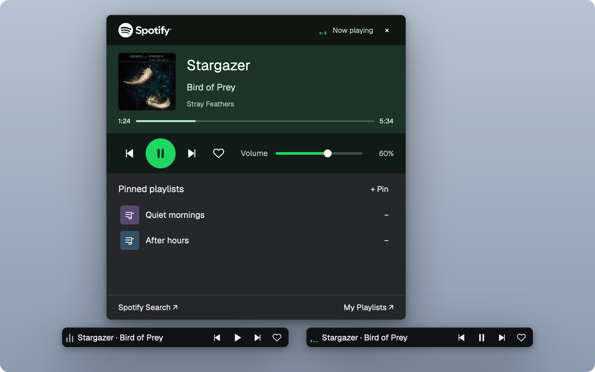

# Spotify Mini

Control the Spotify desktop app on the Mac running Herdr, including from a space on another machine. Spotify Free works. Your sign-in stays in Spotify.

The preview shows the 5:34 version from *Stray Feathers*. [Listen to Stargazer on Spotify](https://open.spotify.com/track/1gWKIOySPIvxvV3GwGA5Rf)

## Playback and Like

The status bar keeps the track, artist, Previous, Play/Pause, Next and Like visible while playing **and while paused**. The equalizer at the left animates during playback and stays still on pause. Long text scrolls within the space beside the controls. Click the equalizer or track to open the player. When Spotify closes or has no track, the resting equalizer opens the player. Hide Names changes the status text and tooltip to “Spotify.”

The heart sends Spotify's **Like/Dislike** shortcut. Clicking again can remove a saved song. Its outline identifies the action. Spotify's desktop scripting interface supplies no reliable saved-state indicator. It only enables for Spotify tracks. The command briefly focuses Spotify and returns to Herdr when Spotify still has focus. [Spotify's keyboard shortcuts](https://support.spotify.com/us/article/keyboard-shortcuts/)

### Keyboard controls

The middle column works anywhere in the active Herdr window with the Spotify status block installed, including when you are typing in a terminal. The right column works inside the open player. The pin form keeps ordinary text-editing keys.

| Action | Anywhere in Herdr | In the player |
|---|---|---|
| Open or close the player | Ctrl+Cmd+M | Escape closes |
| Play or pause | Ctrl+Cmd+P | Space |
| Previous / next | Ctrl+Cmd+Left / Right | Left / Right |
| Lower / raise volume by 10 points | Ctrl+Cmd+Down / Up | Down / Up |
| Like / unlike | Ctrl+Cmd+L | L |

Hover over a status button for its configured shortcut. The global bindings live in `keys.json`.

The player shows album art, album name, elapsed time, track length and a volume slider. Long titles and artist names scroll independently. The sleeve shows a record while artwork is unavailable. The playback keys apply while browsing the player. Letters, spaces and arrow keys in the pin form edit your text.

## Pinned playlists

1. In Spotify, use **Share → Copy link to playlist**.
2. In the mini-player, select **+ Pin**, enter a name, paste the link and select **Save pin**. A Spotify playlist URI also works.
3. Click the saved name to open that playlist in Spotify. Use **−** to unpin it. Pinning the same link with another name updates its existing entry.

**Spotify Search** opens search in the desktop app. **My Playlists** takes you to Spotify's playlists view. Saved pins live in `data/spotify-mini/playlists.json` on this Mac. Git ignores that directory. The mod stores the display names and playlist IDs and discards sharing parameters.

The Mac app’s scripting interface provides the current track and playback controls. It exposes no playlist collection, and the tested desktop app exposed no playlist links in its Playlists accessibility view. Spotify requires Premium to own a personal development-mode app that could read the full library through its Web API. [Spotify’s development-mode guide](https://developer.spotify.com/documentation/web-api/tutorials/february-2026-migration-guide)

Opening the player can download the current album cover from Spotify’s image CDN. The eight newest downloaded covers stay in the ignored `data/spotify-mini/art/` directory.

## macOS permissions

Allow Herdr to control Spotify when macOS asks. Like and My Playlists also send Spotify a keyboard shortcut. If macOS blocks it, open **System Settings → Privacy & Security** and allow Herdr under **Accessibility** and **Automation → System Events**. Playback, search and opening a pinned playlist use the Spotify app directly. The mod needs no developer app, token or subscription.

[Back to the tour](../README.md#spotify-mini)
