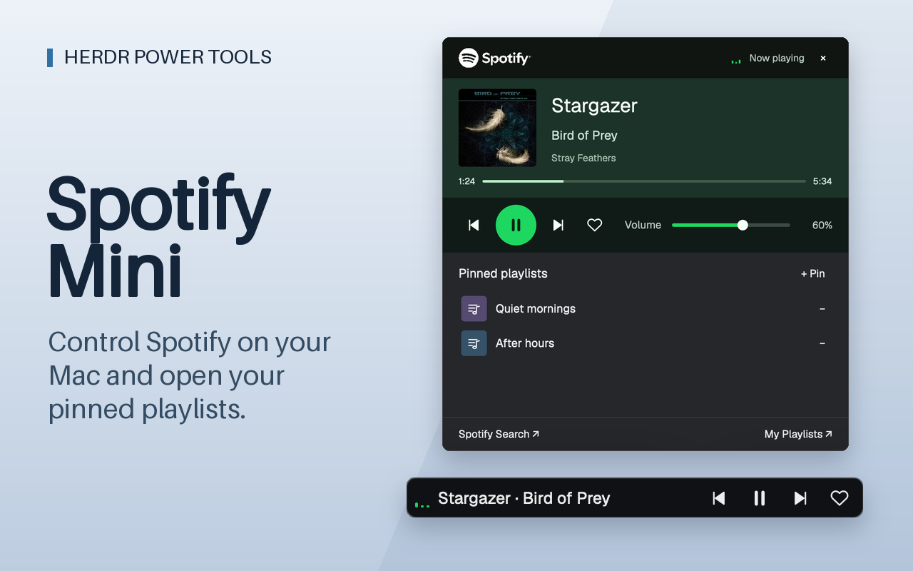

# Spotify Mini

Control Spotify Free on the Mac running Herdr. Like the current song in the status bar and open the playlists you use most.

## What you see

Place a 32 px resting equalizer before the workspace navigation arrows in the 28 px status row. With a loaded track, expand it to 320 px for the track and artist, previous, play/pause, next and an outline heart. Animate the equalizer only during playback. The 460 × 468 px player has the Spotify wordmark, playing indicator, album cover, title, artist, album, elapsed time and duration. Put playback and volume on one row, with pinned playlists, Spotify Search and My Playlists underneath.

## How it behaves

Ctrl+Cmd+M or the status title opens the player. Space toggles playback, Left and Right change tracks, Up and Down change the app volume and L toggles Like. Long labels scroll only when clipped. Pausing preserves every item and its position. Bind Ctrl+Cmd+P to play/pause, Ctrl+Cmd+Left/Right to previous/next, Ctrl+Cmd+Up/Down to volume and Ctrl+Cmd+L to Like throughout Herdr. A pin has a name and a Spotify playlist link. Save it, open it in Spotify or remove it. Saving the same playlist again updates its name.

## Built from

Mount `spotify-mini` with props `{"statusBlock":"spotify-status"}` in a layout block with that ID. Register the player shortcut and the six transport actions from the package keymap. One status copy receives them through `nextCommand()`. The dialog also works on its own. The macOS helper runs through `osascript` and listens for Spotify's playback notifications. Only the open player downloads cover artwork from Spotify’s image CDN. Use a record sleeve if the cover is unavailable. Like and My Playlists use local UI scripting. Search and pinned links open through Launch Services. Pins use expected-text writes under the app home's private data directory.

## Watch out

Keep status reads passive when Spotify is closed. Check the displayed track again before sending the Like/Dislike toggle. Spotify may need macOS Automation permission, and simulated shortcuts need Accessibility. Preserve the user's focus and show permission failures. Keep pin entry separate from player shortcuts.

## Done when

Play a track, pause it and resume from Play in the status bar. Open the dialog with the keyboard, change volume, add a playlist by link and reopen the panel. The pin opens in Spotify, and unpinning it leaves the Spotify library intact.
